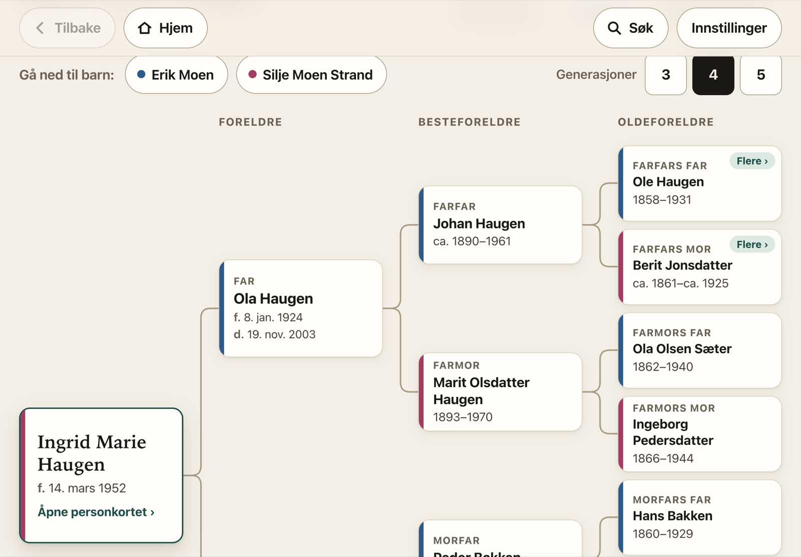
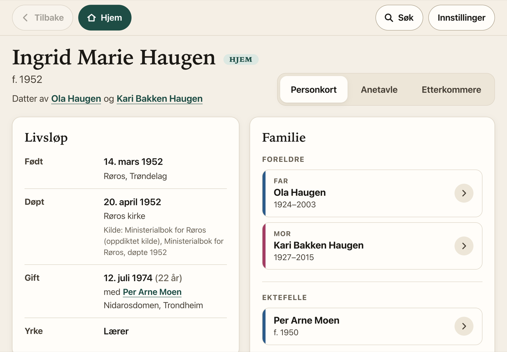
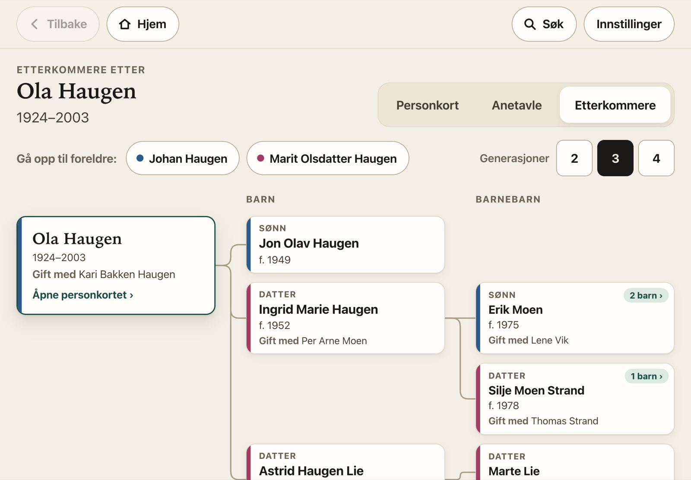
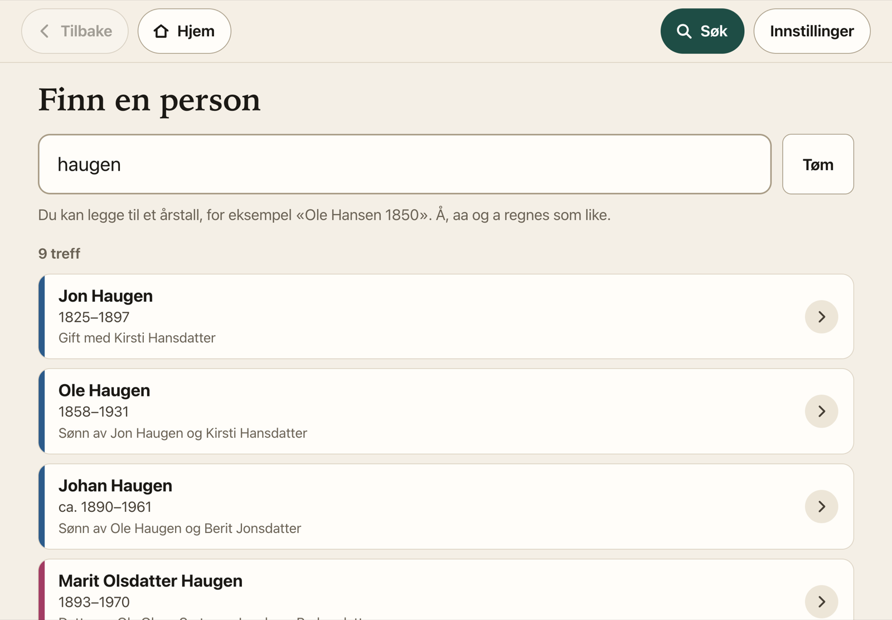
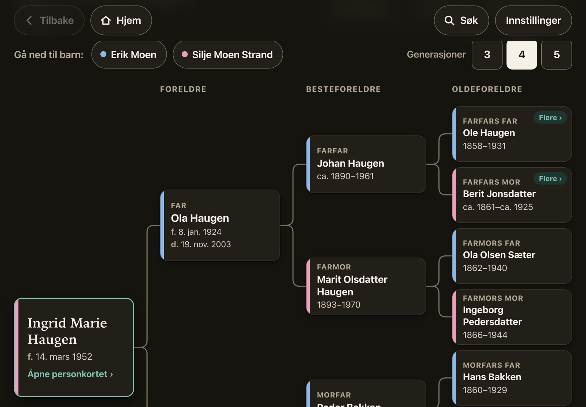

# Slektstre for iPad

Slektstre viser et slektstre fra en GEDCOM-fil (`.ged`) på iPad. Appen har stor tekst, store knapper og ingen sveipebevegelser. Den kan bare vise treet: Redigering, synkronisering og deling gjøres i slektsprogrammet.

Slektsfilen lagres bare på iPaden. Etter installasjonen virker appen uten nett.

**Åpne appen:** https://tabalizer.github.io/slektstre/
**Prøv med eksempelfil:** [`eksempel/eksempel.ged`](eksempel/eksempel.ged). Alle personene i den er oppdiktet.



| Personkort | Etterkommere |
|---|---|
|  |  |
| **Søk** | **Mørkt tema** |
|  |  |

## Hvor slektsfilen ligger

Slektsfiler inneholder som regel opplysninger om levende personer. Derfor gjelder dette:

- GEDCOM-filen leses og lagres bare i nettleseren på enheten (IndexedDB). Den sendes aldri til noen server.
- Nettstedet leverer bare programmet: HTML, CSS og JavaScript. Repoet inneholder ingen slektsdata.
- Appen bruker ingen eksterne skrifttyper, ingen analyseverktøy og ingen tredjepartsskript.

## Installere på iPad

1. Åpne **https://tabalizer.github.io/slektstre/** i **Safari**.
2. Trykk på **Del**-knappen (firkanten med pil opp) og velg **Legg til på Hjem-skjerm**.
3. **Lukk Safari** og åpne Slektstre fra det nye ikonet på Hjem-skjermen.
4. Trykk **Åpne slektsfil** og velg `.ged`-filen i Filer.
5. Velg hvem som skal være **Hjem**, for eksempel deg selv eller en stamfar.

Etter dette trenger appen verken nett eller server.

> **Viktig:** Åpne slektsfilen fra appen på Hjem-skjermen, ikke i Safari. På iPad har Safari og Hjem-skjerm-appen hver sin lagring.

**Slik sjekker du at den virker uten nett:** Slå på flymodus, sveip appen helt bort og åpne den igjen fra Hjem-skjermen. Slektstreet skal komme opp som vanlig.

### Oppdatere slektsfilen

Lag en ny GEDCOM-eksport i slektsprogrammet. Velg deretter **Innstillinger → Last inn ny versjon av filen** i appen. Den gamle filen blir erstattet, og Hjem-personen beholdes hvis den finnes i den nye filen.

## Funksjoner

- **Søk på navn**, eventuelt med årstall («Ole Hansen 1850»):
  - Søket skiller ikke mellom å, aa og a, ø og o, eller æ og ae.
  - Hvert treff viser foreldre eller ektefelle, slik at personer med samme navn kan skilles fra hverandre.
  - Når søkefeltet er tomt, vises personene du nylig har sett på.
- **Personkort** med:
  - livsløp: dato, sted og alder ved hendelsen
  - notater med klikkbare lenker, for eksempel til Digitalarkivet
  - kilder
  - foreldre, søsken og halvsøsken, ektefeller og barn som store knapper
- **Anetavle** med 3–5 generasjoner. Boksene er merket med slektskap: Far, Farmor, Morfars mor osv.
- **Etterkommertre** med 2–4 generasjoner. Ektefeller vises i boksene, og «Mor:» eller «Far:» vises når barna har ulike foreldre.
- **Navigasjon i treet:** Trykk på en person for å flytte treet dit. Treet har egne knapper for å gå ned til barn eller opp til foreldre.
- **Faste knapper** for Tilbake, Hjem og Søk. Safaris egen tilbakeknapp virker også.
- **Tekststørrelsene** Normal, Stor og Ekstra stor. Lyst eller mørkt tema følger enheten.

## Tegnsett: æ, ø og å

Eldre slektsprogram eksporterer ofte i andre tegnsett enn UTF-8, og CHAR-linjen i filhodet stemmer ikke alltid med innholdet. Appen leser derfor filen som bytes og finner tegnsettet selv:

| Tegnsett | Typisk kilde |
|---|---|
| UTF-8 og UTF-16 | Nyere program, for eksempel Legacy, MyHeritage og Gramps |
| ANSEL | Eldre GEDCOM 5.5-eksport. Aksenter som står foran bokstaven, settes sammen riktig. |
| Windows-1252 (ANSI) | Eldre Windows-program |
| DOS (IBM 850/865) | Svært gamle DOS-program |
| MacRoman | Eldre Mac-program |

Hvis filen er gyldig UTF-8, brukes UTF-8. Ellers prøves alle enkeltbyte-tegnsettene, og appen velger det som gir flest vanlige nordiske tegn og færrest tegn som tyder på feil.

Hvis valget likevel blir feil, kan tegnsettet velges manuelt under **Innstillinger → Æ, ø og å**. Der vises også eksempelnavn fra filen, slik at du ser om bokstavene er riktige.

## Begrensninger

- Appen kan bare vise treet, ikke redigere det.
- Bilder og vedlegg (OBJE) vises ikke. Bildene ligger vanligvis som filstier på PC-en der treet ble laget.
- Datoer som ikke følger GEDCOM-formatet, vises slik de står i filen.
- Safari kan slette lagrede data for nettsider som ikke brukes på lenge. Apper på Hjem-skjermen er unntatt fra denne regelen, så bruk appen derfra.

## Utvikling

Appen er vanlig HTML, CSS og JavaScript uten byggesteg og uten avhengigheter.

```sh
python3 -m http.server 8765        # åpne http://localhost:8765
node test/test.js                  # tester tegnsett, datoer, søk og familie
node test/test.js min-fil.ged      # tester også en ekte fil (tid og datoer som ikke kunne tolkes)
```

| Fil | Innhold |
|---|---|
| `js/tegnsett.js` | Gjenkjenner og dekoder tegnsett (UTF-8/16, ANSEL, Windows-1252, DOS, MacRoman) |
| `js/gedcom.js` | Leser GEDCOM, bygger modell for personer og familier, tolker datoer og søker |
| `js/app.js` | Grensesnitt, navigasjon, personkort, anetavle og etterkommertre |
| `sw.js` | Service worker som gjør at appen virker uten nett. Den henter fra nettet når det er mulig, ellers fra lagret kopi. |
| `style.css` | Utseende, med lyst og mørkt tema og tre tekststørrelser |

Nye versjoner publiseres med `git push` til `main`, og GitHub Pages oppdaterer siden automatisk. Når en iPad er på nett, henter appen den nye versjonen neste gang den åpnes.

> Ikke legg ekte `.ged`-filer i repoet. `.gitignore` utelater dem, med unntak av den oppdiktede eksempelfilen.
